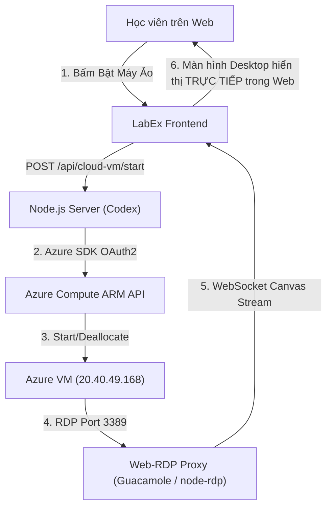

# TÀI LIỆU YÊU CẦU KỸ THUẬT VÀ BÀN GIAO BACKEND CHO CODEX
## HỆ THỐNG LABEX - TỰ ĐỘNG HÓA AZURE CLOUD VM & IN-BROWSER REMOTE DESKTOP

> **Người lập:** Antigravity (Frontend & Content Specialist)  
> **Người nhận:** Codex (Backend & Cloud Orchestration Specialist)  
> **Dự án:** LabEx Local - Hệ thống thực hành Linux & Windows Server 2022 Cloud  
> **Phiên bản:** 2.0 (Cập nhật ngày 19/10/2026)

---

## 1. TỔNG QUAN PHÂN CHIA TRÁCH NHIỆM (DIVISION OF RESPONSIBILITIES)

| Phân hệ | Bên phụ trách | Phạm vi công việc |
|:---|:---|:---|
| **Frontend (FE) & Lab Content** | **Antigravity** | - Thiết kế & hoàn thiện giao diện người dùng: `LabWorkspace`, `WindowsConsole`, `Terminal`, `CourseCatalog`.<br>- Soạn thảo nội dung bài lab hướng dẫn thao tác giao diện đồ họa GUI (Server Manager, ADUC, MMC, IIS, DNS, Group Policy...).<br>- Tích hợp PowerShell Web Console, hiển thị trạng thái máy ảo và bộ nút điều khiển. |
| **Backend (BE) & Cloud Integration** | **Codex** | - Tự động hóa gọi Azure API (`@azure/arm-compute`) để Start/Stop/Deallocate máy ảo thật mà không cần người dùng vào Azure Portal.<br>- Triển khai luồng Stream Màn hình Desktop trực tiếp trong trình duyệt (Web RDP / Guacamole WebSocket) thay vì chỉ tải file `.rdp`.<br>- Xây dựng bộ chấm điểm từ xa (Remote Verifier) cho Windows Server qua WinRM/SSH. |

---

## 2. HIỆN TRẠNG KỸ THUẬT HIỆN TẠI (CURRENT SYSTEM ARCHITECTURE)

### 2.1. Hạ tầng Azure VM hiện có:
- **Tài khoản:** Azure for Students
- **Resource Group:** `LabEx-India-RG` (Khu vực: `centralindia`, Zone 1)
- **Virtual Machine:** `LabEx-WinServer`
- **Cấu hình phần cứng:** `Standard_B2ats_v2` (2 vCPU, 4GB RAM)
- **Địa chỉ IP Public:** `20.40.49.168`
- **Hệ điều hành:** Windows Server 2022 Datacenter
- **Tài khoản quản trị:** `adminlab` / `LabEx2026@Pass!`
- **Các cổng đã mở:** Port 3389 (RDP), Port 80 (HTTP), Port 443 (HTTPS), Port 5985 (WinRM)

### 2.2. Trạng thái Backend hiện tại (`server/`):
1. **Linux Runtime (Đã hoàn thiện 100%):**
   - Chạy trên WSL2 Ubuntu qua Docker Rootless (`minh` user).
   - Đã có cơ chế Self-Healing trong [`server/pty/docker_runner.py`](file:///D:/Project/LabEx/server/pty/docker_runner.py): Nếu socket daemon bị ngắt, tự động khởi động lại sau 1-2 giây.
   - Toàn bộ các khóa học Linux đạt trạng thái **Hands-on Ready (Xanh)**.
2. **Azure VM Management (`server/services/azureVmService.js`):**
   - Hiện đang dùng cơ chế **TCP Socket Probing** vào cổng 3389 của `20.40.49.168`. Khi máy ảo tắt trên Azure, cổng 3389 đóng, API trả về `VM deallocated`. Khi máy ảo bật, trả về `VM running`.
   - **Vấn đề tồn tại:** Nút `POST /api/cloud-vm/start` và `stop` trên web hiện tại chưa thực sự gọi vào API của Microsoft Azure vì chưa có Azure Authentication Credentials (Service Principal hoặc Managed Identity). Người dùng vẫn phải vào `portal.azure.com` để bấm nút Start thủ công.
3. **Kết nối Desktop Windows:**
   - Hiện tại đang cung cấp file `LabEx-WinServer.rdp` qua `GET /api/cloud-vm/connect.rdp`. Người học phải tải file về máy và mở bằng Remote Desktop Connection của Windows.

---

## 3. CÁC NHIỆM VỤ CHI TIẾT CODEX CẦN XỬ LÝ (ACTION ITEMS FOR CODEX)



### Nhiệm vụ 1: Tự động hóa điều khiển Azure VM (Azure API Integration)
- **Mục tiêu:** Khi người dùng bấm nút "Bật Máy Ảo" trên web, máy ảo trên Azure thật sự khởi động. Khi bấm "Tắt Máy", máy ảo tự Deallocate để dừng tính phí.
- **Giải pháp đề xuất:**
  - Cài đặt thư viện: `npm install @azure/identity @azure/arm-compute` trong `server/`.
  - Hỗ trợ 2 phương thức xác thực linh hoạt:
    - **Cách A (Khuyến nghị cho Local Dev):** Sử dụng Azure CLI (`az login` trên máy host). Thư viện `AzureCliCredential` của `@azure/identity` sẽ tự động lấy token từ `az` mà không cần cấu hình key phức tạp.
    - **Cách B (Cho Production/Server):** Tạo App Registration (Service Principal) trên Azure Portal với quyền `Virtual Machine Contributor` trên Resource Group `LabEx-India-RG`, cấu hình biến môi trường:
      ```env
      AZURE_TENANT_ID=...
      AZURE_CLIENT_ID=...
      AZURE_CLIENT_SECRET=...
      AZURE_SUBSCRIPTION_ID=...
      ```
  - Triển khai trong `server/services/azureVmService.js`:
    ```javascript
    import { ComputeManagementClient } from "@azure/arm-compute";
    import { DefaultAzureCredential } from "@azure/identity";

    const client = new ComputeManagementClient(new DefaultAzureCredential(), subscriptionId);

    export async function startAzureVmReal() {
      return await client.virtualMachines.beginStartAndWait("LabEx-India-RG", "LabEx-WinServer");
    }

    export async function stopAzureVmReal() {
      return await client.virtualMachines.beginDeallocateAndWait("LabEx-India-RG", "LabEx-WinServer");
    }
    ```

---

### Nhiệm vụ 2: Màn hình Windows Server Desktop TRỰC TIẾP trong trình duyệt (In-Browser Web RDP)
- **Vấn đề người dùng phản ánh:** *"tôi thấy nút mở màn hình bấm vào nhưng mà nó cho tải một cái file remode về chứ ko hề thấy mở màn hình... tôi muốn hệ thống tập trung nâng cấp cái máy ảo chứ mở remote cũng thấy sao sao..."*
- **Mục tiêu:** Thay vì bắt người dùng tải file `.rdp` về máy tính, hãy nhúng trực tiếp luồng hiển thị màn hình Windows Server 2022 vào thẻ tab trên Web LabEx.
- **Giải pháp đề xuất:**
  1. **Phương án 1 (Chuẩn công nghiệp - Apache Guacamole / Guacamole-Lite):**
     - Chạy `guacd` (Guacamole daemon) dạng container nhẹ trong WSL (`docker run -d --name guacd -p 4822:4822 guacamole/guacd`).
     - Tích hợp `guacamole-lite` vào Node.js HTTP/WebSocket server (`server/server.js`).
     - Frontend chỉ cần sử dụng thư viện `guacamole-common-js` render trực tiếp vào thẻ `<div id="display"></div>`. Học viên gõ chuột, bấm phím và nhìn thấy Desktop Windows Server 2022 mượt mà ngay trên web!
  2. **Phương án 2 (WebRTC / Windows Admin Center Gateway):**
     - Kích hoạt cổng Windows Admin Center hoặc web portal trên máy ảo Azure và nhúng iframe an toàn.

---

### Nhiệm vụ 3: Bộ chấm điểm từ xa cho Windows Server (Remote Verifier Engine)
- **Vấn đề:** Hiện tại lệnh chấm điểm của các bài lab Windows (`verification.js`) đang kiểm tra lịch sử lệnh giả lập local.
- **Mục tiêu:** Khi học viên thực hành trên máy ảo Azure thật (ví dụ: tạo OU `Company_HQ`, tạo User `david.miller`, cấu hình IIS Website cổng `8080`), khi bấm nút "Kiểm tra kết quả" (Verify), backend phải truy vấn sang máy ảo Azure để xác nhận cấu hình đã thực sự được tạo!
- **Giải pháp:**
  - Mở cổng WinRM HTTPS (5986) hoặc OpenSSH trên Windows Server 2022.
  - Xây dựng module `server/services/windowsRemoteVerifier.js`:
    - Sử dụng `ssh` hoặc PowerShell Remoting (`wsman`) với tài khoản `adminlab` / `LabEx2026@Pass!`.
    - Chạy câu lệnh kiểm tra (ví dụ: `Get-ADUser david.miller` hoặc `Get-Website -Name PortalCorp`).
    - Nếu trả về kết quả đúng $\rightarrow$ Trả về `passed: true`.

---

## 4. BẢN ĐỒ CÁC FILE CẦN THAO TÁC TRÊN BACKEND

- `server/services/azureVmService.js`: Chuyển từ TCP port probing sang Azure Compute Management Client thật.
- `server/routes/cloudVm.js`: Tích hợp các hàm bắt đầu, dừng và kiểm tra trạng thái từ Azure SDK.
- `server/server.js`: Nâng cấp WebSocket server để hỗ trợ luồng stream Web RDP (Guacamole tunnel).
- `server/services/verification.js`: Bổ sung provider `windows-remote` cho các bài lab `win-*`.

---

## 5. KẾT LUẬN & ĐỀ NGHỊ PHỐI HỢP
- **Antigravity** đã hoàn thiện toàn bộ Frontend, giao diện điều khiển, thiết kế tab và nội dung hướng dẫn thao tác GUI chi tiết cho các bài lab Active Directory và IIS.
- **Codex** vui lòng tiếp nhận phần Backend Cloud Orchestration theo tài liệu này để hoàn thiện hệ sinh thái Windows Server thực thụ cho dự án!
