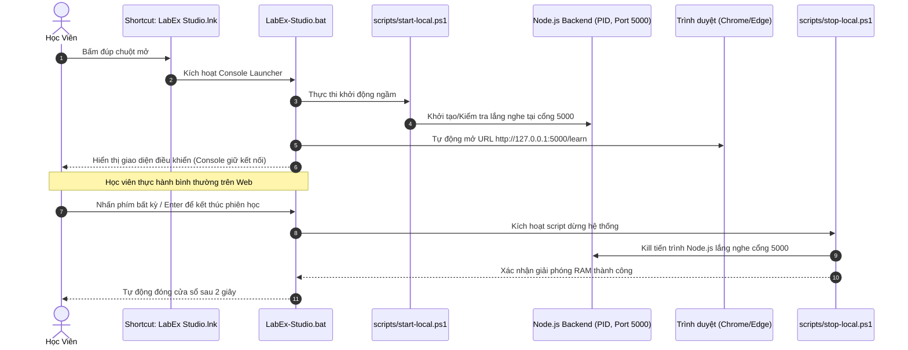

# Tài Liệu Bàn Giao: Unified Desktop Launcher & Server Lifecycle Management

> **Dành cho:** Codex / Backend Maintainer  
> **Ngày cập nhật:** 22/10/2026  
> **Tác giả:** Antigravity  
> **Trạng thái:** Đã triển khai và kiểm thử thành công trên Windows.

---

## 1. Bối cảnh & Yêu cầu của Người Dùng (Problem Statement)
- **Vấn đề trước đây:** Mỗi khi người dùng muốn học tập, họ phải mở VS Code, gõ lệnh hoặc chạy script thủ công để khởi động server cổng 5000 và rootless Docker. Điều này gây tốn thời gian và rào cản thao tác.
- **Vấn đề khi dùng 2 icon tách biệt (Start / Stop):** Rất dễ xảy ra tình trạng người dùng học xong tắt trình duyệt nhưng quên bấm icon tắt server, dẫn đến tiến trình server vẫn chạy ngầm chiếm RAM (~96MB).
- **Giải pháp tối ưu đã thống nhất:** Tích hợp thành **1 ICON DUY NHẤT** mang tên `LabEx Studio.lnk` trên màn hình Desktop, hoạt động theo mô hình *Lifecycle Console Launcher* (tương tự Docker Desktop, XAMPP, LM Studio).

---

## 2. Kiến trúc & Vòng đời hoạt động (Architecture & Lifecycle)

---

## 3. Danh mục Files & Mã Nguồn Liên Quan

### 3.1. `LabEx-Studio.bat` (Thư mục gốc)
- **Vai trò:** Cửa sổ quản lý vòng đời chính.
- **Nội dung:**
  - Chạy `scripts/start-local.ps1` với ExecutionPolicy Bypass.
  - Mở URL `http://127.0.0.1:5000/learn`.
  - Giữ lệnh `pause >nul` để người dùng kiểm soát phiên học.
  - Khi có tín hiệu nhấn phím, gọi `scripts/stop-local.ps1` để giải phóng bộ nhớ.

### 3.2. `scripts/start-local.ps1`
- **Vai trò:** Khởi động máy chủ Node daemon ngầm và runtime Docker rootless (WSL).
- **Cải tiến quan trọng:** Đã nâng deadline chờ từ 10s lên 25s (`$deadline = (Get-Date).AddSeconds(25)`) nhằm đảm bảo khi Docker rootless khởi động chậm (cold-start) vẫn không bị timeout giả mạo.

### 3.3. `scripts/stop-local.ps1`
- **Vai trò:** Dừng sạch sẽ tiến trình LabEx trên cổng 5000.
- **Logic:**
  - Truy vấn `Get-NetTCPConnection -LocalPort 5000 -State Listen`.
  - Lấy `OwningProcess` tương ứng và thực hiện `Stop-Process -Id $ownerId -Force`.
  - Thông báo hoàn tất giải phóng RAM.

### 3.4. `scripts/create-desktop-shortcuts.ps1`
- **Vai trò:** Tự động tạo shortcut ra màn hình Desktop (hỗ trợ cả Desktop cục bộ và OneDrive Desktop).
- **Logic dọn dẹp:** Tự động xóa các file shortcut cũ nếu tồn tại (`LabEx - Hoc Tap.lnk`, `LabEx - Tat Server (Giai phong RAM).lnk`), và ghi đè shortcut duy nhất `LabEx Studio.lnk` trỏ về `LabEx-Studio.bat`.

---

## 4. Lưu ý Kỹ Thuật cho Codex khi Phát Triển Tiếp
1. **Kiểm tra cổng 5000:** Mọi tác vụ backend cần giữ quy ước cổng `5000` cho local web server. Không tự ý đổi cổng mà không cập nhật các script launcher.
2. **Bộ nhớ RAM:** Tiến trình Node.js backend hiện tại chạy rất nhẹ (~96MB - 100MB RAM khi idle). Nếu tích hợp thêm worker hoặc microservice, cần đảm bảo `scripts/stop-local.ps1` quét sạch các PID con liên quan để tránh leak RAM.
3. **Thực thi trên Windows:** Toàn bộ lệnh gọi PowerShell từ file `.bat` luôn cần cờ `-NoProfile -ExecutionPolicy Bypass` để không bị chặn bởi chính sách bảo mật PowerShell của Windows.
