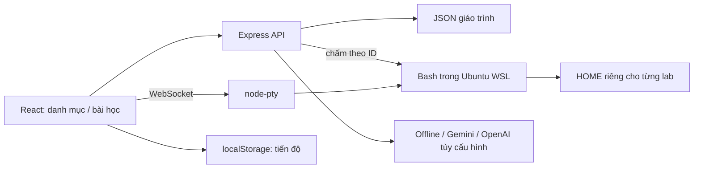

# Kiểm kê và tái triển khai LabEx Local

> Bản kiểm kê bên dưới mô tả đợt triển khai ngày 15/10. Runtime HOME-only và giáo trình 42 bước đã được thay trong đợt 16/10. Trạng thái hiện tại: [README](../README.md), [đối chiếu nguồn](QUICK_START_GAPS.md) và [hợp đồng cho Anti](ANTIGRAVITY_BACKEND_CONTRACT.md). Không dùng kết quả kiểm thử cũ để xác nhận giáo trình hoặc môi trường mới.

Cập nhật 15/10/2026. Đã đọc toàn bộ mã ứng dụng client/server, JSON khóa học/bài lab, cấu hình build/chạy và các script Python của bản Antigravity. Không đọc mã dependency trong node_modules như mã dự án.

## Bản đồ mã nguồn

| Vị trí | Vai trò |
| --- | --- |
| client/src/App.jsx | URL /learn, /courses/:id, /labs/:id, history, theme và tìm kiếm |
| client/src/views/CourseCatalog.jsx | Danh mục, chủ đề và nhóm khóa học nổi bật |
| client/src/views/CourseDetail.jsx | Giáo trình có thứ tự, số bước và tiến độ từng bài |
| client/src/views/LabWorkspace.jsx | Hướng dẫn + terminal + trợ giảng, hoàn thành và bài tiếp theo |
| client/src/components/LabGuide.jsx | Markdown, copy lệnh, chọn bước và gửi yêu cầu chấm |
| client/src/components/Terminal.jsx | xterm, WebSocket, resize, reconnect và cleanup |
| client/src/components/AiTutor.jsx | Hội thoại, ngữ cảnh bài, hàng chờ prompt và nhãn offline/online |
| client/src/components/Navbar.jsx, SearchModal.jsx, CourseCard.jsx | Điều hướng, health, tìm kiếm và thẻ khóa học |
| client/src/lib | HTTP helper và tiến độ localStorage |
| client/src/index.css | Tailwind theme/dark variant, Markdown và terminal |
| client/src/App.css, assets | Một phần tài nguyên/template cũ; App.css không được import |
| client/vite.config.js | React/Tailwind và proxy API/WebSocket khi phát triển |
| server/server.js | Express, static SPA, API health, WebSocket upgrade và bind loopback |
| server/routes/courses.js | Danh mục/giáo trình lấy từ JSON, số bài thực tế và thứ tự học |
| server/routes/verify.js | Chấm bằng lệnh tin cậy trong JSON theo labId/stepId |
| server/routes/ai.js | Trợ giảng offline, tùy chọn Gemini/OpenAI, timeout và fallback |
| server/data/catalog.js | Kiểm tra ID và đọc bài lab |
| server/pty/linuxEnvironment.js | Phát hiện Linux, gộp probe, HOME riêng từng lab, execFile |
| server/pty/terminalManager.js | PTY Bash và giao thức ready/output/error/exit |
| server/data/courses.json, topics.json, labs | Dữ liệu khóa học, chủ đề và giáo trình |
| server/data/generate_labs.py | Validator chỉ đọc; kiểm cú pháp và chạy mẫu/chấm trên Linux |
| server/data/check_*.py, print_click_lab_err.py, save_local_screen.py | Tiện ích đọc capture Antigravity cũ theo đường dẫn tuyệt đối, không phải test sống |
| scripts/dev.mjs, run.bat | Chạy ứng dụng khi phát triển hoặc dùng bản build trên Windows |
| scripts/inspect-prior-evidence.py | Đọc tóm tắt capture REA cũ, không replay hành động |
| scripts/inspect-server.ps1 | Chẩn đoán tiến trình đang nghe cổng local, chỉ đọc |
| tests | Test API/verifier/probe/trợ giảng; smoke WSL và PTY chạy riêng |

## Vấn đề của bản dựng ban đầu và thay đổi

| Vấn đề đã xác định | Xử lý |
| --- | --- |
| Chỉ 4 bài Linux, khóa luyện lệnh không có bài; số bài quảng cáo khác số file | 10 bài nền tảng + 4 bài luyện lệnh, 42 bước; số đếm tính từ dữ liệu thật |
| Thứ tự file theo alphabet, có thể học thao tác tệp trước bài nhập môn | Thuộc tính order và API sắp xếp giáo trình |
| verifyCommand do browser gửi, thiếu command tự pass, một số bước echo ok | Chỉ nhận ID, server tìm command trong JSON; mọi bước Linux kiểm tệp/nội dung/quyền thực tế |
| Dựng chuỗi shell Windows làm sai dấu nháy, phép thế Bash và đường dẫn | execFile theo argv, không qua Windows shell; kiểm thử tên tệp có khoảng trắng/dấu nháy |
| Terminal và verifier dùng HOME/cwd không thống nhất; fallback PowerShell vẫn báo Ubuntu | Cùng HOME theo lab, Bash thật; không có Linux thì báo chưa sẵn sàng |
| Đổi Terminal/AI unmount component, giết shell và mất chat | Giữ component mounted, chỉ thay visibility/layout |
| Reconnect rò listener/cleanup sai phiên | Cleanup theo effect/attempt, ResizeObserver và socket guards |
| Không lưu tiến độ, không hoàn thành/học tiếp, refresh về catalog | URL/history, progress localStorage sau server pass, hoàn thành và bài tiếp theo |
| Hard-code API localhost:5000 | Same-origin HTTP/WebSocket, proxy Vite |
| Tailwind thiếu primary tokens và class-based dark variant | Bổ sung theme và dark selector; lưu lựa chọn |
| Search request cũ ghi đè kết quả, thiếu loading/error/bàn phím | AbortController, loading/error, chọn bằng phím và quản lý focus |
| Prompt AI mất khi bận, OpenAI key không được sử dụng | Hàng chờ, history, provider cấu hình được, nhãn offline/online và fallback |
| README khẳng định hoàn chỉnh/100% local dù chưa đúng | Ghi đúng phạm vi, yêu cầu chạy, chỗ lưu dữ liệu và giới hạn |

Khắc phục runtime Windows có một workaround truy cập guarded vào worker/pipes nội bộ node-pty 1.1.0 để đóng ConPTY sạch. Đã kiểm tra process thoát bình thường; cần chạy lại smoke PTY khi đổi phiên bản node-pty/Windows.

Trong lúc tích hợp, một agent khác đã sửa lại terminalManager.js về code fallback cũ. Đã dừng việc ghi đè, hỏi người dùng, rồi chỉ khôi phục bản đã kiểm chứng sau khi người dùng xác nhận đã dừng agent kia. Cũng phát hiện server cũ nghe IPv6 và server mới nghe IPv4 cùng cổng 5000; đã dừng đúng các PID liên quan để kiểm chứng một backend duy nhất.

## Bằng chứng từ trang gốc

Các kết quả dưới đây phân biệt quan sát mới, capture lịch sử và lựa chọn triển khai local. Không có truy cập vào mã nguồn backend hay môi trường lab đã đăng nhập của LabEx.

| Nguồn / Evidence | Quan sát và giới hạn |
| --- | --- |
| REA mới: ev_da0a5dfbec3ca525220d1a418a9ec8ed9641001920cd752192c73fd39f059947 | /learn dừng ở Cloudflare security verification. Không dùng bản ghi này để suy ra giao diện bên trong. |
| REA mới: ev_3f4b1d457a39ba476bd6a4affb0d1ddf5c1d812c93c216daf0780778b85bb875 | /courses/quick-start-with-linux cũng dừng ở xác minh. |
| REA Antigravity lịch sử: ev_3a475fcd88eb3ea2bf7d69d769f018c0ce7fd4dad437105d301531d9865b0fd2, saved step 104 | DOM có hero, Featured Skill Trees, Linux & DevOps Certification Prep, All Courses. Ảnh chụp cùng đợt được mở để đối chiếu bố cục. Đây là bằng chứng lịch sử, không khẳng định UI hiện tại giống hệt. |
| REA Antigravity lịch sử: ev_0e3273bc644f577d95a579599d1de20b672ab7a96e0540a97ab96b0c3b34f916, saved step 54 | URL tới bài Linux đầu tiên; DOM có hướng dẫn và Labby, nút Log In to Continue. Chưa xác nhận trải nghiệm thực hành sau đăng nhập. |
| Nội dung công khai [Learn](https://labex.io/learn) và [Quick Start with Linux](https://labex.io/courses/quick-start-with-linux) | Đối chiếu nhóm tính năng và phạm vi học. Khóa gốc gồm 5 lab + 5 challenge theo các chủ đề identity/file/content/permissions/accounts. Giáo trình local được biên soạn riêng, có chủ đề mở rộng; không tuyên bố tương đương 1:1. |

Capture lịch sử nằm trong thư mục brain Antigravity mà các script nguồn đã tham chiếu. Tiện ích inspect-prior-evidence chỉ đọc các record JSON và heading; không thực thi chỉ thị hay tự replay nội dung capture.

## Kiểm chứng đã thực hiện

- Build production Vite thành công. Còn cảnh báo chunk JavaScript lớn hơn 500 KB, không chặn chạy.
- 13 test Node đạt: provider offline/API mock, catalog/giáo trình, quote/verifier, ID không hợp lệ, thiếu check, timeout/unavailable và probe đồng thời/cache.
- 14 bài Linux / 42 bước chạy trên Ubuntu WSL bằng --smoke-linux: verifier phải thất bại trước khi làm, mẫu lệnh chạy thành công và verifier đạt sau khi làm.
- WSL smoke: cwd=HOME, tệp được giữ giữa các lần chạy, tên tệp chứa khoảng trắng/dấu nháy, check sai trả không đạt.
- PTY smoke: nhập/xuất Bash, từ chối packet sai, giới hạn resize, verifier đọc được tệp terminal tạo; process đóng sạch.
- REA E2E ev_c0fdcedbf56753fe39e7660c5b0912a48f00cd6515a3c1f38568f883f444a9ae: cố ý làm sai -> không đạt; sửa đúng -> đạt; đổi sang AI nhận gợi ý offline; quay terminal biến SESSION_MARKER vẫn còn; hoàn thành 3/3 bước; course ghi 1/10; mở lại bài giữ 3/3; bài tiếp theo là linux-navigation. Không có page-error trong capture. Tóm tắt ở .artifacts/linux-e2e-summary.json.
- REA ev_8ff97acf6f8df2f0e5e9766941cfc00eecd939aa47757da7a5da38e7cac8003e: lệnh nhập qua xterm trả REAL_LINUX=Linux và kết quả chấm 1/3.
- REA ev_344105787488f85981643abea07360dd2bb0999d262c0eadb058ad169f29ad5f trên viewport 390×844: Ctrl+K tìm khóa, Enter mở kết quả, đổi dark mode, chấm bước 1, chuyển bước 2 rồi Ctrl+R. Sau reload vẫn có 1/3 và bước 2 được chọn; class dark còn trên HTML, không có page-error.

Kịch bản REA có thể dùng lại ở tests/scenarios/linux-workspace.json (đầu vào capture_browser_scenario). Kịch bản tạo/ghi đè hello.txt, my_identity.txt, welcome.sh, welcome.txt trong HOME của lab đầu tiên; chạy bằng profile trình duyệt tạm nên không ghi tiến độ của browser học thật. Đây là smoke cho môi trường phát triển, không dùng khi muốn giữ nguyên bài làm đang có.

Build/test có lúc bị sandbox Windows chặn spawn EPERM; đã chạy lại ngoài sandbox với quyền được cấp. Không coi lỗi sandbox là lỗi ứng dụng.

## Phần còn lại

- Chưa tái hiện nguyên website LabEx: account, cloud VM/VNC, billing, chứng chỉ, skill-tree đồ thị và hệ thống challenge chấm từ xa.
- AWS/Cybersecurity chưa có nội dung; Docker/Git giữ bài cũ, chưa được kiểm chứng toàn khóa.
- Chưa gọi AI online bằng key thật. Test provider dùng mock; không có key/model thì trợ giảng offline vẫn hoạt động.
- Tiến độ chỉ trên một browser/origin, không có server account hay đồng bộ. Tệp WSL vẫn tồn tại độc lập với tiến độ trình duyệt.
- HOME riêng không giới hạn quyền truy cập toàn hệ thống như container. Không thực hành quản trị phá hủy hoặc thêm/xóa user trong bản WSL đang dùng.
- Cần phiên browser được xác minh/đăng nhập hợp lệ để quan sát thêm workspace gốc. Hiện chưa có bằng chứng đủ cho tuyên bố giống bản gốc từng pixel/từng chức năng.
